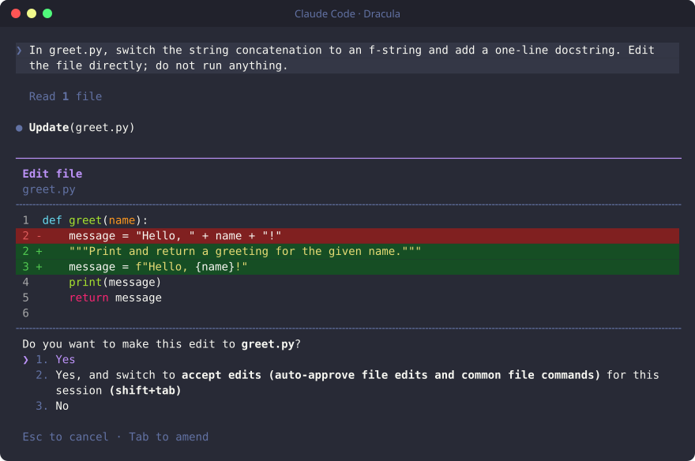
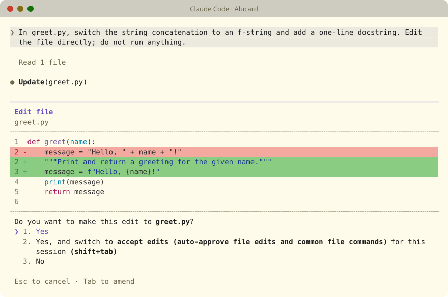

# Dracula for Claude Code

[Dracula](https://draculatheme.com) themes for the Claude Code terminal UI. Both
official variants are included, the dark Dracula and the light Alucard, and
each one sets all 72 colours Claude Code lets a theme change.


| Dracula | Alucard |
|---|---|
|  |  |

## Requirements

- Claude Code 2.1 or newer (any version with custom theme support)
- `bash`, plus `curl` or `wget` for the one-line install
- `python3` or `jq` if you want the installer to switch the theme on for you

## Installation

### Quick install

```sh
curl -fsSL https://raw.githubusercontent.com/vishwajitsarnobat/dracula-claude-code/main/install.sh | bash -s -- --activate dracula
```

This installs both themes and makes Dracula the active one. Use
`--activate alucard` for the light theme instead, or leave the option out to
install the themes without switching to either.

### From a clone

```sh
git clone https://github.com/vishwajitsarnobat/dracula-claude-code.git
cd dracula-claude-code
./install.sh --activate dracula
```

### Manual

1. Download [`dracula.json`](themes/dracula.json) or
   [`alucard.json`](themes/alucard.json) from the `themes` folder.
2. Copy it into `~/.claude/themes/`, creating the folder if it does not exist.
3. Open Claude Code, run `/theme` and pick it.

You can also set it directly in `~/.claude/settings.json`:

```json
{
  "theme": "custom:dracula"
}
```

## Usage

Run `/theme` in Claude Code to switch between Dracula, Alucard and the built-in
themes. Changes apply straight away, so there is no need to restart.

### Match your terminal

Claude Code colours its own interface but not the terminal behind it, so your
terminal background should match the theme. The easiest way is to install
Dracula for your terminal from [draculatheme.com](https://draculatheme.com). If
you would rather not, set the background colour by hand:

| Theme | Background |
|---|---|
| Dracula | `#282a36` |
| Alucard | `#fffbeb` |

Your terminal also needs truecolour support. Most modern terminals have it. If
colours look slightly off, check that `COLORTERM=truecolor` is set.

## Installer options

| Option | Description |
|---|---|
| `-t`, `--theme NAME` | Install only `dracula` or `alucard`. Can be repeated. |
| `-a`, `--activate [NAME]` | Make `NAME` the active theme. The name can be left out when installing a single theme. |
| `-d`, `--dir PATH` | Install into `PATH` instead of `~/.claude/themes`. |
| `-l`, `--list` | List the available themes. |
| `-h`, `--help` | Show help. |

If your Claude Code config lives somewhere other than `~/.claude`, set
`CLAUDE_CONFIG_DIR` and both scripts will use it.

The installer only changes the `theme` key in `settings.json`. Everything else
in the file is kept as it is, and a symlinked `settings.json` stays a symlink.

## Uninstall

```sh
./uninstall.sh
```

This removes `dracula.json` and `alucard.json`. If one of them was active, the
theme is set back to Claude Code's built-in `dark` theme, or `light` if you were
using Alucard. Use `--keep-setting` to leave `settings.json` untouched, or
`--fallback NAME` to choose which built-in theme to go back to.

## Troubleshooting

**The theme does not show up in `/theme`.** Check that the file is in
`~/.claude/themes/` (or `$CLAUDE_CONFIG_DIR/themes/`) and that your Claude Code
version supports custom themes.

**Colours look washed out inside tmux.** Claude Code uses 256 colours instead of
truecolour when it runs inside tmux, so the shades are approximate there.

**Code in diffs is not in Dracula colours.** Claude Code picks the colours for
highlighted code itself (Monokai for dark themes, GitHub for light ones) and a
theme cannot change them. To turn code highlighting off, add
`"syntaxHighlightingDisabled": true` to `settings.json`. The red and green diff
lines still use the Dracula colours.

## How the colours are chosen

Every colour comes from the official
[Dracula specification](https://draculatheme.com/spec), and the themes are
generated from it by `scripts/generate.py`.

- Each Claude Code colour takes the Dracula colour that plays the same part.
  Errors are Red, success is Green, Claude's own colour is Orange, and dim text
  and borders use Comment, as the spec suggests for subtle borders.
- Dracula has no blue. Its terminal palette uses Purple for blue and Pink for
  magenta, and the themes follow that. Permission prompts and suggestions are
  Purple, and auto-accept, skills and bash mode are Pink.
- The animated shimmer colours are the spec's bright terminal colours, so the
  red shimmer is Bright Red `#ff6e6e`. The spec has no bright Orange or Comment.
  Those two use the same lightness step as the six bright colours it does
  define.
- Message and input backgrounds come from the spec's UI palette, such as
  Background Light `#343746` and Selection `#44475a`.
- The red and green diff lines are the only colours the spec does not cover.
  They keep the hue of Red and Green and are darkened (or lightened, for
  Alucard) until text on them is easy to read.

Text contrast on the diff backgrounds, against the 4.5:1 the spec asks for:

| Theme | Changed line | Changed word |
|---|---|---|
| Dracula | 9.17:1 | 5.48:1 |
| Alucard | 8.65:1 | 6.42:1 |

## Development

Only Python 3 is needed.

```sh
python3 scripts/generate.py           # rebuild themes/ from the palette
python3 scripts/generate.py --check   # fail if themes/ is out of date
python3 scripts/validate.py           # check the theme files
./scripts/screenshots.sh              # retake the previews (needs claude and tmux)
```

`scripts/palette.json` holds the colours copied from the spec. Files in
`themes/` are generated, so edit `scripts/generate.py` instead and regenerate.
`validate.py` checks the theme files independently of the generator. That
matters because Claude Code silently ignores any colour name it does not
recognise, so a typo would otherwise go unnoticed.

## Credits

Colours from the [Dracula Theme](https://draculatheme.com) by Zeno Rocha and
contributors.

## License

[MIT](LICENSE)
